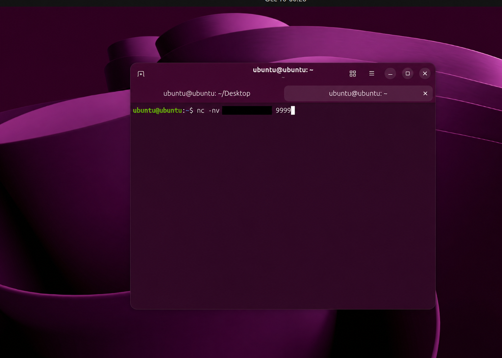
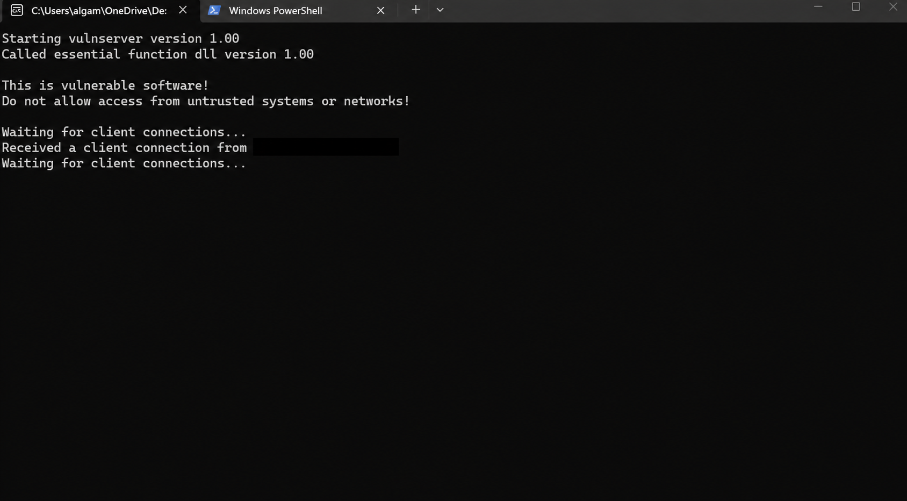
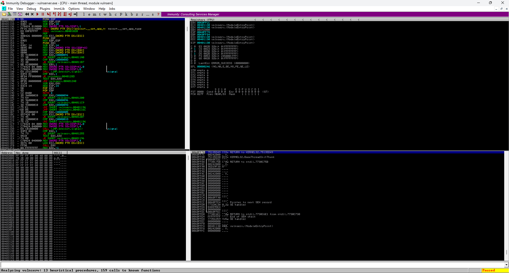
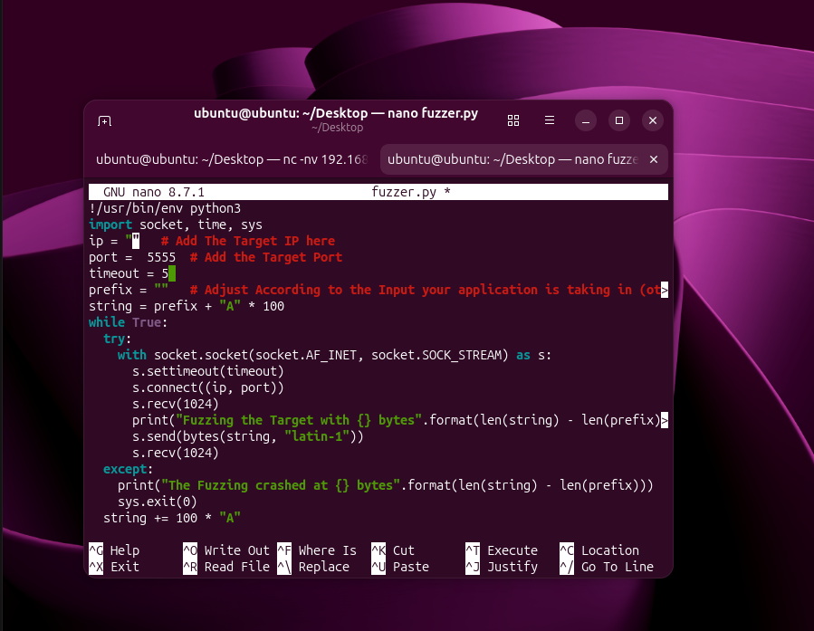
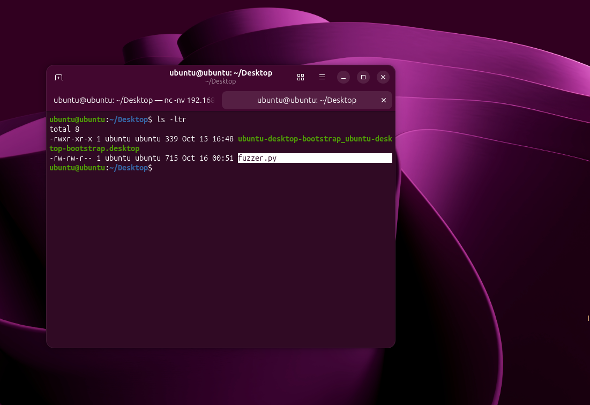
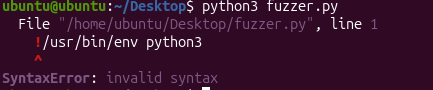
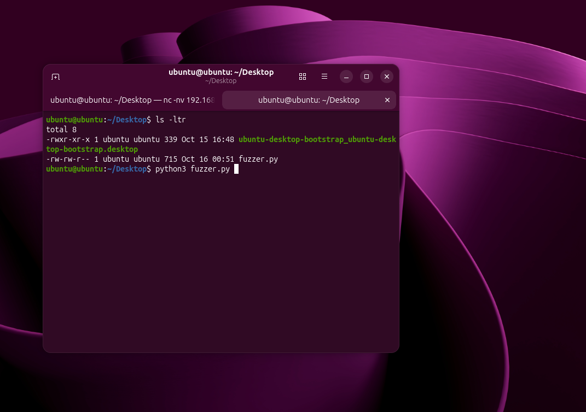
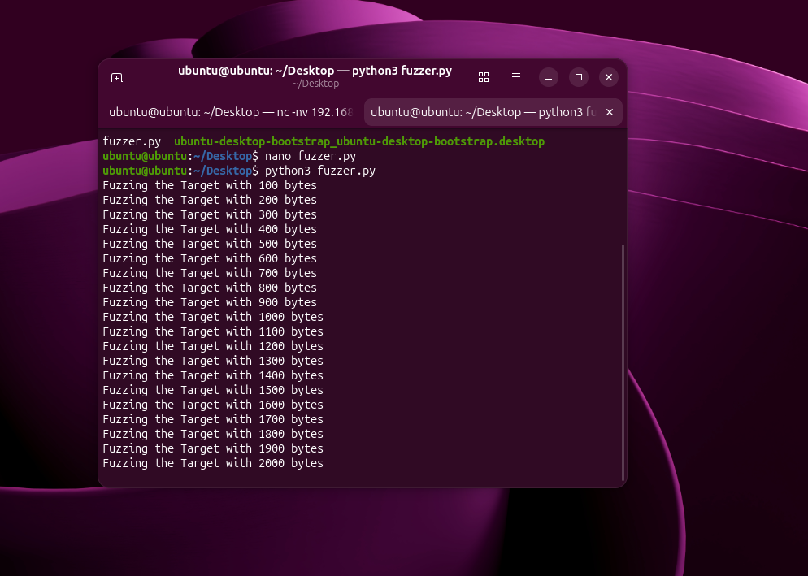
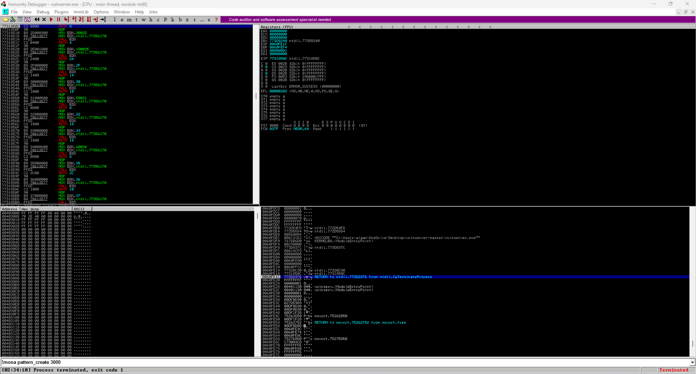

# Vulnserver Buffer Overflow Fuzzing and Crash Analysis

I used this write-up to keep a record of my Vulnserver practice. I tested the `TRUN` command in an isolated lab, used Immunity Debugger to watch the process, and wrote a small Python fuzzer from Ubuntu. My notes ended at the first crash; I had not yet confirmed control of EIP or completed an exploit.

## Lab setup

| Machine | What I used it for |
| --- | --- |
| Windows VM | I ran Vulnserver and attached Immunity Debugger. |
| Ubuntu VM | I ran the Python fuzzer and used netcat. |

I kept the target address out of this public write-up and used `TARGET_IP` in the command example.

**Tools I used:**
- [Immunity Debugger](https://www.immunityinc.com/products/debugger/) on Windows
- [Vulnserver](https://github.com/stephenbradshaw/vulnserver) as the intentionally vulnerable target
- [mona.py](https://github.com/corelan/mona) in Immunity Debugger
- Python 3 and netcat on Ubuntu

## Progress log

### 1. Confirmed the target connection

I used netcat from Ubuntu to confirm that my Windows target answered on port 9999 before I began fuzzing. I replaced the address with a placeholder in this example:

```bash
nc -nv TARGET_IP 9999
```



I also checked the Vulnserver console and saw the incoming connection.



### 2. Attached Immunity Debugger to Vulnserver

I opened `vulnserver.exe` in Immunity Debugger, ran it with F9, and confirmed that the debugger was attached before I sent test input.



### 3. Wrote the fuzzer

I wrote `1_fuzzer.py` in nano on Ubuntu. It sent the `TRUN` command with a buffer of `A` characters, increasing the buffer by 100 bytes after each send until the connection stopped responding.





On my first run, I hit a syntax error because the shebang line, `#!/usr/bin/env python3`, had lost its leading `#` during copy and paste. I corrected the line before continuing.



### 4. Ran the fuzzer

I ran the script with Python 3:

```bash
python3 fuzzer.py
```





I watched the payload increase from 100 bytes in 100-byte steps as each send completed.

### 5. Observed the crash

Vulnserver stopped responding, and Immunity Debugger showed the resulting crash.



I recorded EIP as `7731850C`, which was inside `ntdll`; it had not yet been overwritten with my input (`41414141`). I treated this as an initial crash checkpoint, not as proof that I controlled execution. I still needed to determine whether a larger buffer would reach EIP or whether this crash path involved SEH.

## What I still needed to do

I planned to increase the buffer and check EIP. If it still crashed in `ntdll`, I planned to inspect SEH. After confirming control, I planned to find the offset, check bad characters, and locate a jump gadget. I had not written or tested shellcode yet.

All testing described here took place against Vulnserver in my isolated lab environment.
